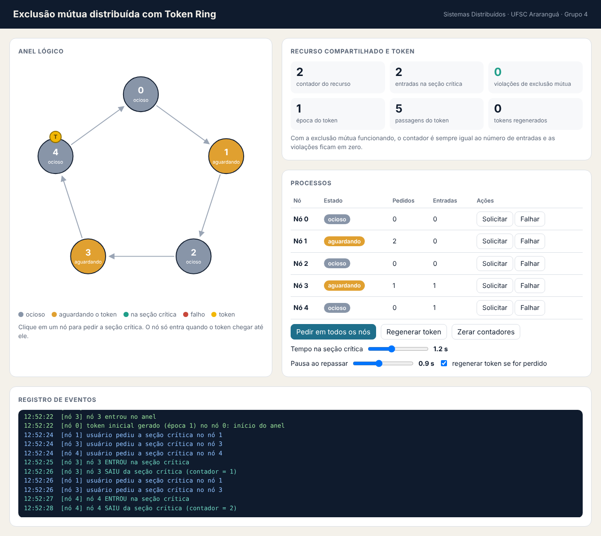
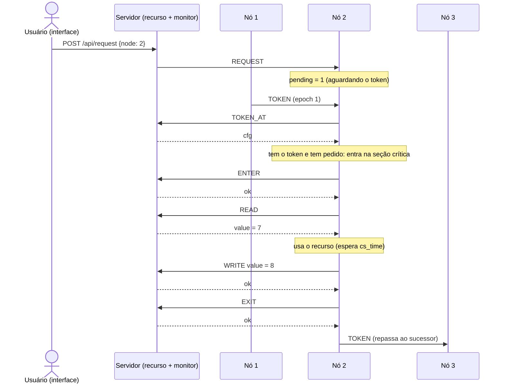
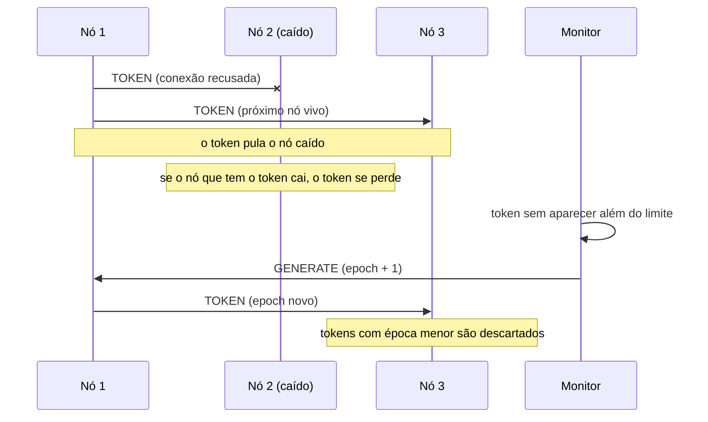

# Exclusão mútua distribuída com Token Ring

**Disciplina:** Sistemas Distribuídos · UFSC, Campus Araranguá
**Trabalho Prático · Grupo 4** (tema: *Algoritmo de Exclusão Mútua distribuído baseado no Token Ring*)
**Integrantes:** João Pinto Ferreira · Ebenezer Pedro
**Linguagem:** Python 3.8+ (somente biblioteca padrão, nada para instalar)



## 1. Proposta do trabalho

Implementamos o algoritmo de exclusão mútua distribuída **Token Ring**. Um conjunto de N processos
forma um anel lógico: o processo `i` só envia mensagens ao processo `(i+1) mod N`. Existe um único
**token**, que circula pelo anel. Um processo só pode usar o recurso compartilhado (a *seção crítica*)
enquanto está com o token. Se não precisa do recurso, repassa o token imediatamente ao sucessor.

Para mostrar o algoritmo funcionando de ponta a ponta, o trabalho tem três partes:

| Parte | Arquivo | Papel |
|---|---|---|
| **Nós do anel** | `node.py` | N processos independentes (um por terminal ou máquina). Implementam o algoritmo Token Ring. |
| **Servidor do recurso** | `server.py` | Guarda o recurso compartilhado (um contador), detecta violações da exclusão mútua, monitora o anel e serve a interface web. Os nós são **clientes** dele. |
| **Interface web** | `ui/index.html` | Mostra o anel, o token, o estado de cada processo, os contadores e o log. Permite pedir a seção crítica, derrubar e recuperar nós e ajustar os tempos. |

O recurso compartilhado é um contador que cada nó incrementa dentro da seção crítica em três passos:
**ler, esperar um tempo, escrever valor+1**. Sem exclusão mútua, dois nós leriam o mesmo valor e uma
atualização se perderia. Por isso, **se o algoritmo está correto, o contador final é sempre igual ao
número de entradas na seção crítica** e o número de violações é zero. A interface e os testes
automáticos verificam essa invariante.

Além do algoritmo básico, tratamos duas situações reais:

* **Falha de um nó:** se o sucessor não responde, o nó tenta o seguinte do anel (o token "pula" o nó caído).
* **Perda do token:** se o nó que tinha o token cai, o token se perde. O monitor (no servidor) percebe
  que o token não aparece há um tempo e **gera um novo token com uma época maior**. Tokens de épocas
  antigas são descartados pelos nós, o que evita dois tokens ativos ao mesmo tempo.

## 2. Requisitos funcionais

### 2.1 Identificação dos processos

* Cada nó tem um **número de processo** de `0` a `N-1`, passado em `--id`.
* Todos conhecem a lista de endereços do anel (`--ring host:porta,host:porta,...`). A posição na lista é o número do processo.
* O **sucessor** do nó `i` é o nó `(i + 1) mod N`. Por padrão o nó `i` escuta em `127.0.0.1:(6000+i)`.
* O servidor do recurso escuta em TCP `:5000` e a interface web em HTTP `:8000`.

### 2.2 Requisitos do nó (cliente do anel e cliente do recurso)

| Requisito | Descrição |
|---|---|
| RF1 | Manter a fila de pedidos de seção crítica (`pending`). |
| RF2 | Receber o `TOKEN` do antecessor. |
| RF3 | Com o token e com pedido pendente: entrar na seção crítica (`ENTER`, `READ`, `WRITE`, `EXIT` no servidor) e só depois repassar o token. |
| RF4 | Sem pedido pendente: repassar o token ao sucessor. |
| RF5 | Se o sucessor não responde, enviar o token ao próximo nó vivo. |
| RF6 | Descartar tokens de época menor que a maior já vista. |
| RF7 | Atender os comandos do monitor: `REQUEST` (pedido do usuário), `GENERATE` (novo token), `PING`. |

### 2.3 Requisitos do servidor

| Requisito | Descrição |
|---|---|
| RS1 | Manter o recurso compartilhado (contador) e responder `READ` e `WRITE`. |
| RS2 | Registrar `ENTER` e `EXIT` e contar **violações** quando dois nós estão dentro ao mesmo tempo. |
| RS3 | Verificar periodicamente se cada nó está vivo (`PING`). |
| RS4 | Gerar o token inicial quando todos os nós estiverem no ar. |
| RS5 | Gerar um novo token (época + 1) se o token não aparecer dentro do tempo limite. |
| RS6 | Servir a interface web e a API que a interface usa. |
| RS7 | (Opcional) Iniciar, derrubar e reiniciar os processos dos nós. |

### 2.4 Mensagens do protocolo

Todas as mensagens são **JSON de uma linha sobre TCP** (`protocol.py`). Cada conexão carrega uma
mensagem e, quando indicado, uma resposta.

| Mensagem | Origem → destino | Campos | Resposta |
|---|---|---|---|
| `TOKEN` | nó `i` → nó sucessor | `epoch`, `from` | nenhuma |
| `REQUEST` | servidor → nó | – | `{ok, pending}` |
| `GENERATE` | servidor → nó | `epoch` | `{ok}` |
| `PING` | servidor → nó | – | `PONG` |
| `HELLO` | nó → servidor | `node` | nenhuma |
| `TOKEN_AT` | nó → servidor | `node`, `epoch`, `from` | `{cfg}` (tempos) |
| `TOKEN_SENT` | nó → servidor | `node`, `to` | nenhuma |
| `ENTER` / `EXIT` | nó → servidor | `node` | `{ok}` |
| `READ` | nó → servidor | `node` | `{value}` |
| `WRITE` | nó → servidor | `node`, `value` | `{ok}` |
| `STATE`, `LOG`, `TOKEN_DROPPED` | nó → servidor | informativas | nenhuma |

## 3. Comunicação entre cliente e servidor

Há dois tipos de comunicação:

1. **Entre os nós (anel):** só existe a mensagem `TOKEN`, enviada do nó `i` para o sucessor.
2. **Entre cada nó (cliente) e o servidor do recurso (servidor):** pedido e resposta (`ENTER`, `READ`, `WRITE`, `EXIT`), mais mensagens de acompanhamento para a interface.

### Diagrama de sequência: um nó usa a seção crítica



### Diagrama de sequência: nó caído e token perdido



## 4. Descrição do serviço e execução no servidor

O serviço oferecido pelo servidor é o **acesso exclusivo a um contador compartilhado**.
O servidor não decide quem entra: quem decide é o token. O servidor apenas **audita** (`ENTER` e `EXIT`) se a exclusão mútua foi respeitada.

Como o servidor executa o serviço (`server.py`):

* Uma `ThreadingTCPServer` recebe as mensagens dos nós, uma thread por conexão, e chama `Monitor.on_message`.
* O estado (contador, quem está dentro, entradas, violações) fica protegido por um `RLock`.
* Uma thread de monitoramento roda a cada 0,4 s: faz `PING` em cada nó, gera o token inicial e verifica o tempo limite do token.
* Um `ThreadingHTTPServer` serve `ui/index.html` e a API JSON (`/api/state`, `/api/request`, `/api/fail`, `/api/recover`, `/api/regenerate`, `/api/config`, `/api/reset`).

O algoritmo no nó (`node.py`), em resumo:

```text
ao receber TOKEN(epoca):
    se epoca < maior_epoca_vista: descarta
    senão:
        se há pedido pendente: seção crítica (ENTER, READ, esperar, WRITE, EXIT)
        envia TOKEN ao sucessor (se não responder, ao próximo nó vivo)
```

## 5. Trechos de código

### 5.1 Envio e recepção de mensagens (`protocol.py`)

```python
def encode(msg: dict) -> bytes:
    """Serializa uma mensagem como uma linha JSON terminada em \n."""
    return (json.dumps(msg, ensure_ascii=False) + "\n").encode("utf-8")

def send(addr, msg, timeout=1.5) -> bool:
    """Envia uma mensagem sem esperar resposta. Retorna False se não conseguiu entregar."""
    try:
        with socket.create_connection(addr, timeout=timeout) as s:
            s.sendall(encode(msg))
        return True
    except OSError:
        return False
```

Recepção no nó (`node.py`): cada conexão é uma linha JSON, lida e despachada para `Node.handle`.

```python
class Handler(socketserver.StreamRequestHandler):
    def handle(self):
        line = self.rfile.readline()
        msg = json.loads(line)
        reply = self.server.node.handle(msg)       # TOKEN, REQUEST, GENERATE, PING
        if reply is not None:
            self.wfile.write((json.dumps(reply) + "\n").encode())
```

### 5.2 Definição dos números dos processos e do anel (`node.py`)

```python
ring = [parse_addr(a) for a in args.ring.split(",")]   # índice na lista = número do processo
node = Node(args.id, ring, parse_addr(args.server))
host, port = ring[args.id]                             # endereço onde este nó escuta
# sucessor = ring[(id + 1) % n]  (ver forward_token)
```

### 5.3 Recebimento do token e uso da seção crítica (`node.py`)

```python
def on_token(self, msg):
    with self.lock:
        stale = msg.get("epoch", 0) < self.epoch
        if not stale:
            self.epoch = msg.get("epoch", 0)
    if stale:                                  # token de época antiga: descarta
        self.report({"type": "TOKEN_DROPPED", "epoch": msg.get("epoch", 0)})
        return
    ...
    with self.lock:
        wants = self.pending > 0
        if wants:
            self.pending -= 1
    if wants:
        self.critical_section()
    time.sleep(self.cfg["pass_delay"])         # só para a animação ficar legível
    self.forward_token()

def critical_section(self):
    self.set_state("cs")
    self.report({"type": "ENTER"}, want_reply=True)
    value = (self.report({"type": "READ"}, want_reply=True) or {}).get("value", 0)
    time.sleep(self.cfg["cs_time"])            # trabalho com o recurso
    self.report({"type": "WRITE", "value": value + 1}, want_reply=True)
    self.report({"type": "EXIT"}, want_reply=True)
```

### 5.4 Envio do token ao sucessor, pulando nós caídos (`node.py`)

```python
def forward_token(self):
    msg = {"type": "TOKEN", "epoch": self.epoch, "from": self.id}
    for k in range(1, self.n):
        target = (self.id + k) % self.n        # sucessor, depois o seguinte, ...
        if send(self.ring[target], msg):
            self.report({"type": "TOKEN_SENT", "to": target})
            return
    # nenhum outro nó vivo: o token volta para mim
```

### 5.5 Auditoria da exclusão mútua no servidor (`server.py`)

```python
elif kind == "ENTER":
    if self.in_cs:                             # alguém já estava dentro: violação
        self.violations += 1
    self.in_cs.add(node)
    self.entries += 1
elif kind == "WRITE":
    self.counter = msg["value"]
elif kind == "EXIT":
    self.in_cs.discard(node)
```

### 5.6 Regeneração do token (`server.py`)

```python
lost = (self.token_started and alive_n > 0 and self.auto_regen
        and time.time() - self.last_token_time > self.token_timeout())
...
self.epoch += 1                                # época maior invalida o token antigo
send(self.addrs[target], {"type": "GENERATE", "epoch": epoch})
```

## 6. Instalação e execução

### 6.1 Requisitos

* **Python 3.8 ou superior.** Não há bibliotecas para instalar (apenas a biblioteca padrão).
* Um navegador (Chrome, Firefox, Edge) para a interface.
* Portas livres: `5000` (servidor), `8000` (interface) e `6000` a `6000+N-1` (nós).

### 6.2 Execução rápida (tudo em uma máquina)

```bash
git clone <https://github.com/joaopintoferreira/token-ring-sd-grupo4.git>
cd token-ring-sd-grupo4
python server.py --nodes 5
```

Depois abra **http://localhost:8000**. O servidor inicia os 5 nós sozinho, gera o token e o anel começa a funcionar.
No Windows, se `python` não for reconhecido, use `py server.py --nodes 5`.

**O que fazer na interface:**

1. Clique em um nó (no desenho ou em **Solicitar**) ou em **Pedir em todos os nós**: o nó fica laranja (aguardando) até o token chegar, depois verde (na seção crítica).
2. Observe que o **contador** é sempre igual às **entradas** e as **violações** ficam em 0.
3. Clique em **Falhar** em um nó: ele fica vermelho e o token passa direto por ele. **Recuperar** o traz de volta.
4. Falhe o nó que está com o token: ele se perde. Depois do tempo limite, o monitor gera um novo (a "época" sobe e "tokens regenerados" aumenta).
5. Os controles deslizantes ajustam o tempo na seção crítica e a pausa ao repassar o token.

Opções úteis do servidor: `--nodes N`, `--cs-time S`, `--pass-delay S`, `--http-port P`, `--port P`, `--node-port P`, `--token-timeout S`.

### 6.3 Execução distribuída (cada nó em um terminal ou máquina)

No servidor (máquina A, IP `192.168.0.10`), sem iniciar os nós:

```bash
python server.py --no-spawn --node-addrs 192.168.0.11:6000,192.168.0.12:6001,192.168.0.13:6002
```

Em cada máquina de nó, com o mesmo `--ring` e o próprio `--id` (o servidor já está em `192.168.0.10:5000`):

```bash
python node.py --id 0 --ring 192.168.0.11:6000,192.168.0.12:6001,192.168.0.13:6002 --server 192.168.0.10:5000
python node.py --id 1 --ring 192.168.0.11:6000,192.168.0.12:6001,192.168.0.13:6002 --server 192.168.0.10:5000
python node.py --id 2 --ring 192.168.0.11:6000,192.168.0.12:6001,192.168.0.13:6002 --server 192.168.0.10:5000
```

Quando todos os nós estiverem no ar, o servidor gera o token. Nesse modo, os botões Falhar/Recuperar ficam desativados (o servidor não controla os processos remotos). Para simular falha, encerre o `node.py` com Ctrl+C.
Libere as portas no firewall se necessário.

### 6.4 Testes automáticos

```bash
python tests/test_ring.py
```

O teste sobe um anel de 4 nós em portas próprias (5100, 6100 e 8100) e verifica: (1) exclusão mútua com pedidos concorrentes (contador == entradas, 0 violações, cada nó entra o mesmo número de vezes); (2) falha de um nó; (3) token perdido e regeneração; (4) recuperação dos nós. Dura cerca de 15 segundos.

## 7. Estrutura do repositório

```
token-ring/
├── README.md          este relatório
├── protocol.py        formato das mensagens e envio/recepção sobre TCP
├── node.py            nó do anel (algoritmo Token Ring)
├── server.py          servidor do recurso, monitor, supervisor e API da interface
├── ui/index.html      interface web
├── tests/test_ring.py testes automáticos
└── docs/interface.png captura da interface
```

## 8. Limitações

* O monitor (servidor) é um ponto único de falha **para a interface e a regeneração do token**. O anel em si não depende dele para circular: se o servidor cair, os nós perdem o acesso ao recurso, que fica no servidor.
* A regeneração do token é decidida por tempo limite. Se o limite for curto demais para o tempo configurado de uso, o token pode ser considerado perdido sem ter sido. As épocas evitam dois tokens ativos, mas há uma janela curta em que ambos existem; a interface contaria isso como violação.
* Os processos conversam por TCP sem autenticação; o trabalho é uma demonstração didática.

## Referências

* TANENBAUM, A. S.; VAN STEEN, M. *Sistemas Distribuídos: Princípios e Paradigmas*. Seção sobre exclusão mútua distribuída.
* COULOURIS, G. et al. *Sistemas Distribuídos: Conceitos e Projeto*. Seção sobre exclusão mútua (algoritmo baseado em anel).
